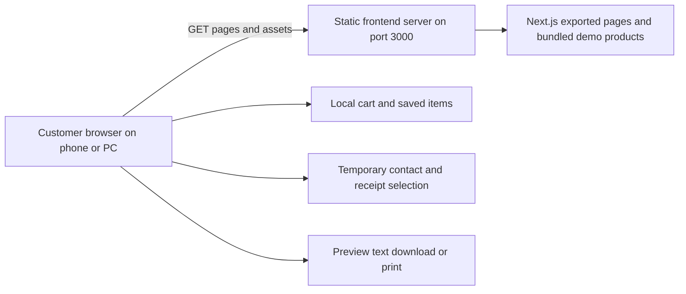
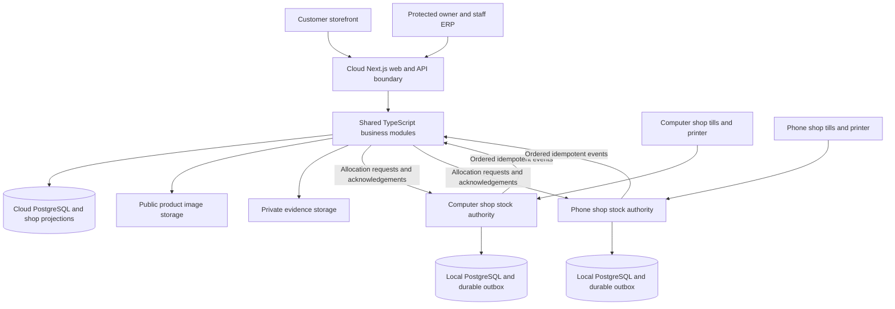
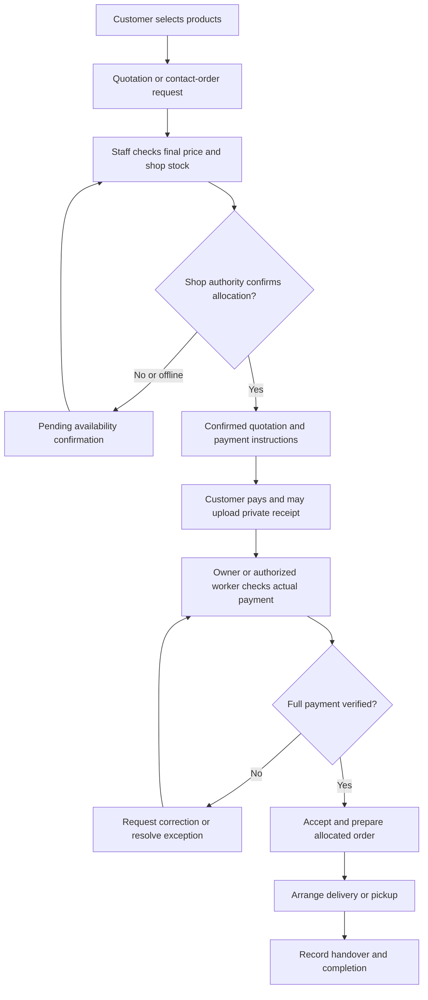
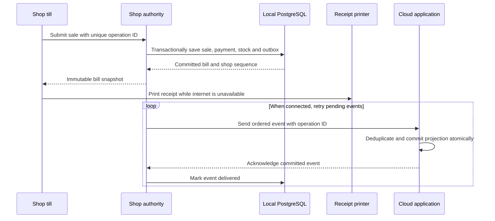

# Architecture and business diagrams

Only the first diagram is implemented. The remaining diagrams describe the proposed connected phase, not live APIs or services. Mermaid blocks render in compatible Markdown viewers; editable `.mmd` sources are alongside this file.

## Current frontend

[Mermaid source](current-system.mmd)

## Proposed connected system

[Mermaid source](target-system.mmd)

## Proposed customer order flow

[Mermaid source](order-flow.mmd)

## Proposed offline billing and sync

[Mermaid source](offline-sync.mmd)

Offline billing assumes the local host and LAN remain powered. Cloud requests cannot finalize stock allocation without the shop authority. Uploading a receipt does not mark payment verified. Printing or retrying synchronization must not create another sale.
